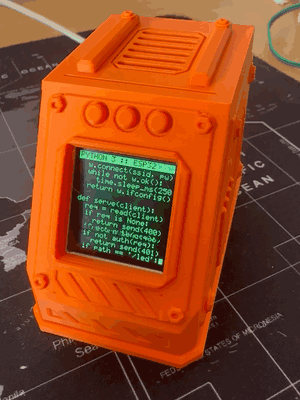
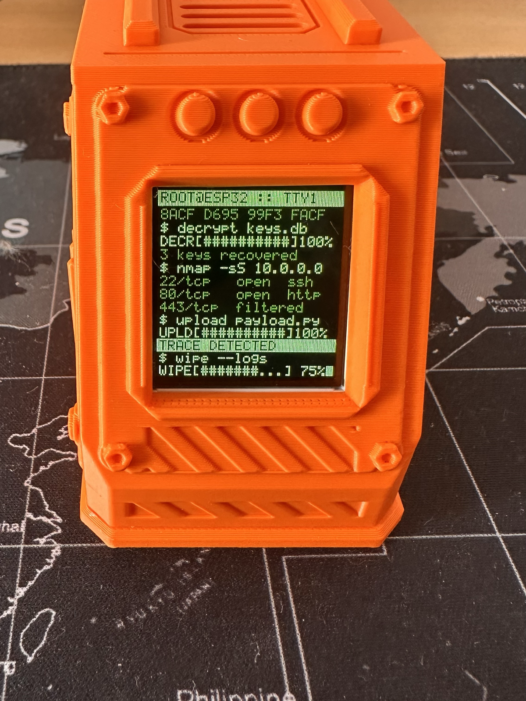
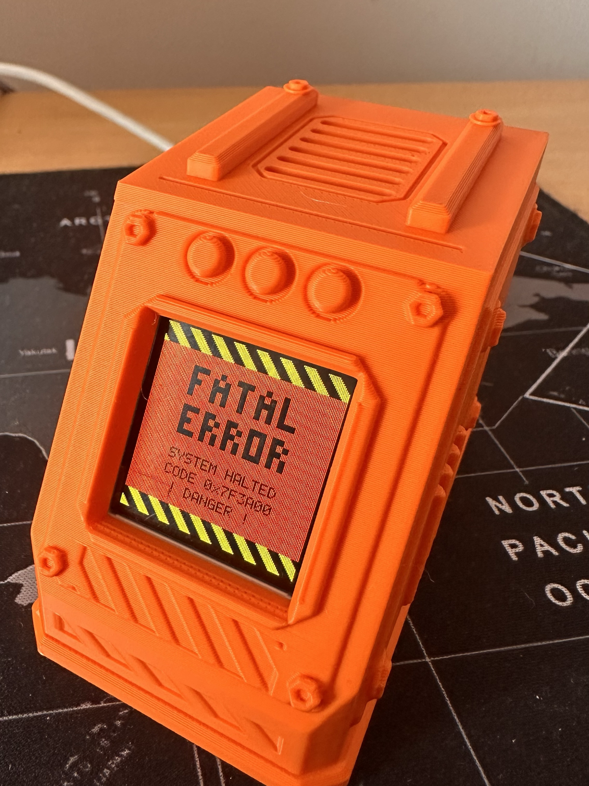
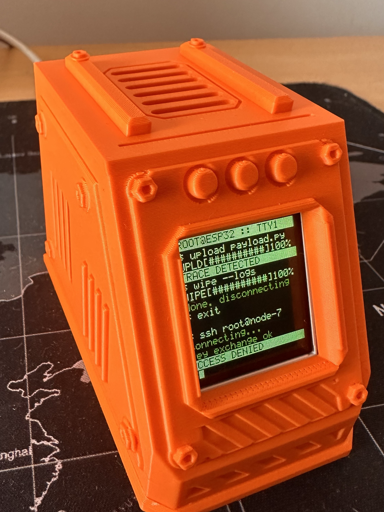
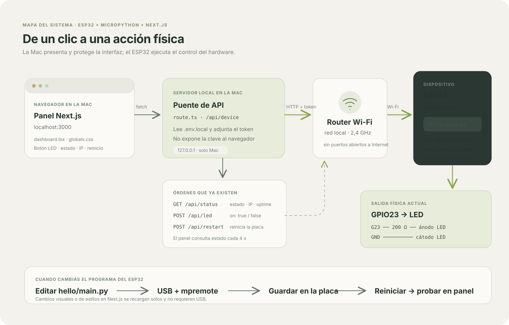
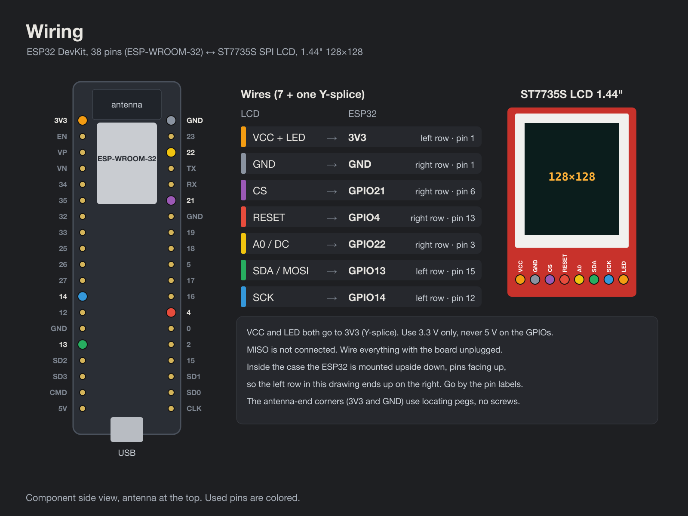
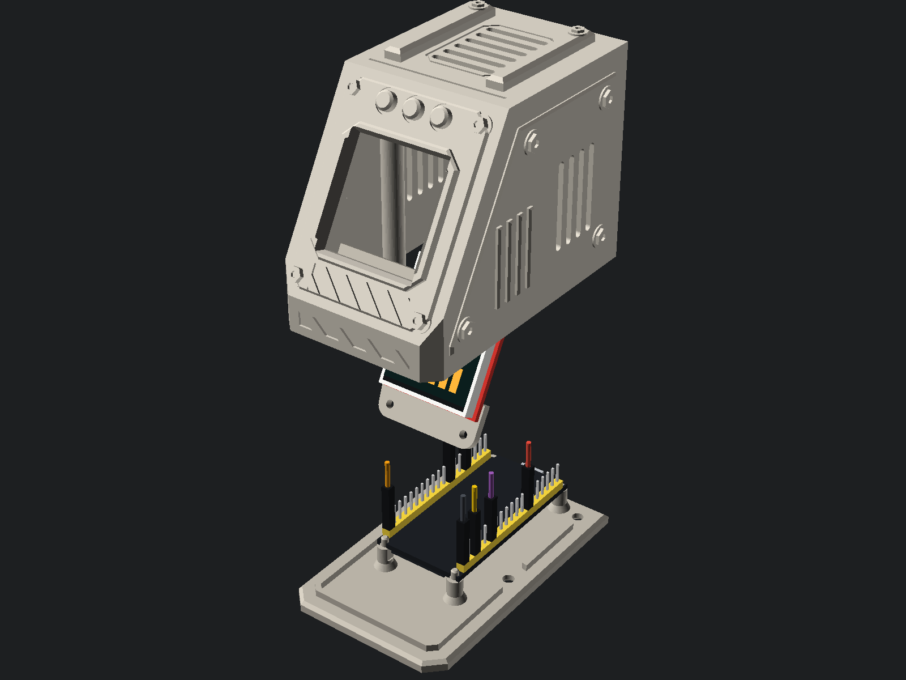
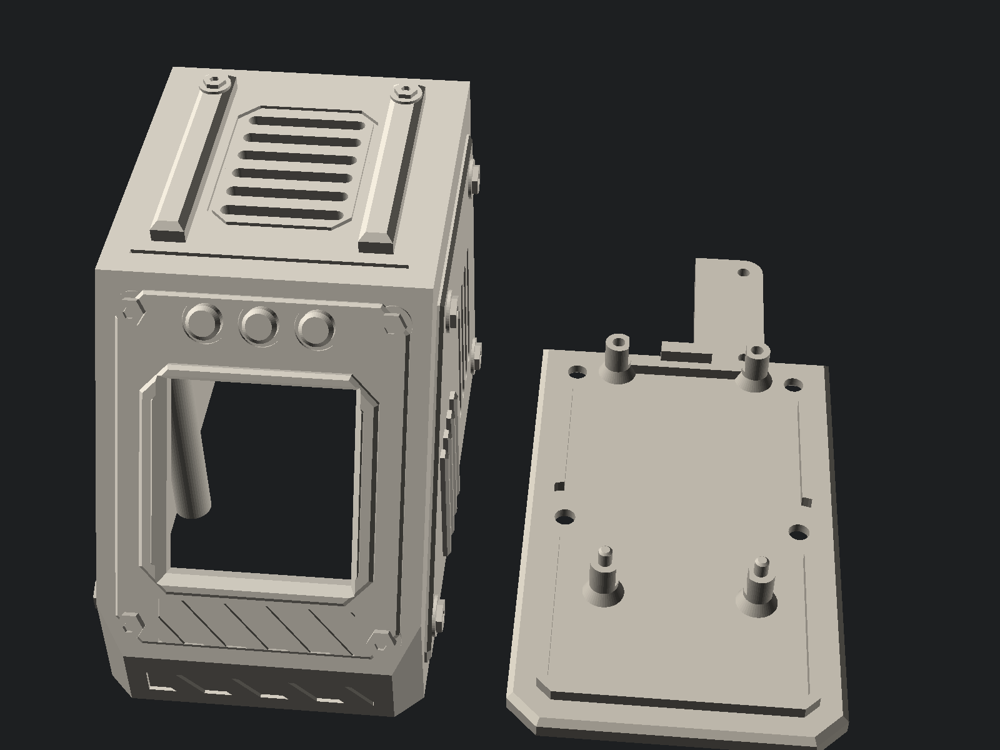

# ESP32 Retro Sci-Fi Console

A small desk console built from an ESP32 DevKit and a 1.44" ST7735S screen. It has a 3D-printed retro-futuristic case, MicroPython firmware with animated screen modes, and a local Next.js panel to control it over Wi-Fi.

<p align="center">
  
</p>

<p align="center">
  
  
  
</p>

> Guía completa en español: [GUIA.md](GUIA.md) · Comandos rápidos: [CHEATSHEET.md](CHEATSHEET.md)

## Contents

| Folder | What's inside |
|---|---|
| [`case/`](case) | 3D-printable case: Bambu Studio project, STL files, parametric OpenSCAD source and the [assembly guide (PDF)](makerworld/documentation/assembly_guide.pdf) |
| [`firmware/`](firmware) | MicroPython firmware for the ESP32: display driver, screen modes, Wi-Fi API and USB demos |
| [`makerworld/`](makerworld) | MakerWorld listing: covers, photos, video, assembly guide and description |
| [`docs/`](docs) | Architecture and wiring diagrams |



## Screen modes

| Mode | Description |
|---|---|
| `status` | Online and Wi-Fi state, plus the board's local IP |
| `console` | Green terminal that types and scrolls real fragments of the firmware's own Python code |
| `hacker` | Hacker-movie terminal: commands, progress bars, hex dumps and alerts |
| `fatal` | Blinking red "FATAL ERROR" alarm with hazard stripes |
| `weather` | Current weather and today's chance of rain for a city (default Buenos Aires) from [Open-Meteo](https://open-meteo.com), a free public API with no key. The board only queries it while this scene is on screen, at most every 15 minutes |
| `forecast` | The next three days for the same city: day, icon, high, low and chance of rain. It shares the weather query, so it is fetched under the same rules |
| `sunset` | Pixel-art sunset |
| `colors` | RGB565 color grid to check colors and edges |
| `animation` | Bouncing orb with trail and shadow |
| `text` | Your own message, up to two lines of 15 characters |
| `random` | Switches to a different scene every 20 seconds |

The driver draws in 8-row strips through a 2 KB buffer and only redraws what changed, so the animations run at about 15–23 fps on the ESP32.

## Hardware

- ESP32 DevKit, 38 pins (ESP-WROOM-32, CP2102 USB serial)
- ST7735S SPI LCD, 1.44", 128×128 (red PCB, 30 × 44 mm)
- 8 female-female Dupont wires, micro-USB data cable
- For the case: 2 × M2.5 × 6 self-tapping screws, 2 × M2 × 6 screws, 4 × M3 × 10 countersunk screws, optional rubber feet

### Wiring

| LCD | ESP32 |
|---|---|
| VCC + LED | 3V3 |
| GND | GND |
| CS | GPIO21 |
| RESET | GPIO4 |
| A0 / DC | GPIO22 |
| SDA / MOSI | GPIO13 |
| SCK | GPIO14 |

MISO is not connected. Use 3.3 V only. Connect by GPIO label, not by physical position.



## Quick start

### 1. Flash and load the firmware

Requires Python 3. From the repository root:

```sh
python3 -m venv .venv
source .venv/bin/activate
cd 01-console/firmware
python -m pip install esptool mpremote
mpremote connect list
PORT=/dev/cu.usbserial-0001   # your board's serial port
```

If the board doesn't have MicroPython yet, download the [ESP32_GENERIC](https://micropython.org/download/ESP32_GENERIC/) firmware as `firmware.bin` and flash it. This erases the board.

```sh
python -m esptool --chip esp32 --port "$PORT" erase-flash
python -m esptool --chip esp32 --port "$PORT" write-flash 0x1000 firmware.bin
```

Create your secrets file and generate a token:

```sh
cp wifi_secrets.py.example wifi_secrets.py
python -c 'import secrets; print(secrets.token_hex(32))'
```

Fill in `WIFI_SSID`, `WIFI_PASSWORD` and `API_TOKEN` in `wifi_secrets.py`, then copy the files and reset:

```sh
mpremote connect "$PORT" fs cp wifi_secrets.py :wifi_secrets.py &&
mpremote connect "$PORT" fs cp font5x7.py :font5x7.py &&
mpremote connect "$PORT" fs cp display_ui.py :display_ui.py &&
mpremote connect "$PORT" fs cp weather.py :weather.py &&
mpremote connect "$PORT" fs cp main.py :main.py &&
mpremote connect "$PORT" reset
```

The screen shows the board's IP when it boots.

### 2. Run the panel

The Next.js control panel lives in its own repository: [esp32-sci-fi-retro-panel](https://github.com/lamaro/esp32-sci-fi-retro-panel). Its README covers the full setup, from flashing the board to running the panel.

## The case

<p align="center">
  
  
</p>

- Outer size 53 × 83 × 67 mm, single color, prints without supports.
- The ESP32 is mounted upside down so the Dupont wires have room. The micro-USB port is flush with the back.
- The screen is mounted with its pins at the top, so the firmware rotates the image 180° (MADCTL `0x08`, window offset column 2, row 1).

| File | Use |
|---|---|
| [`case/esp32_scifi_console.3mf`](case/esp32_scifi_console.3mf) | Bambu Studio project: shell, base and screen bracket on one plate (A2L, PLA, 0.20 mm, about 3 h and 79 g) |
| [`case/stl/`](case/stl) | The three parts as separate STL files |
| [`case/reference/`](case/reference) | ESP32 and screen models, for reference only |
| [`case/source/`](case/source) | Parametric OpenSCAD model, render scenes and wiring diagram |
| [`makerworld/documentation/assembly_guide.pdf`](makerworld/documentation/assembly_guide.pdf) | Bill of materials, wiring and step-by-step assembly |

Some ESP32 clones have different hole spacing. Print the base first (about 30 minutes) to check the fit, and adjust `esp_hole_span` in `case/source/scifi_console.scad` if needed.

## USB demos

From `01-console/firmware/`, with the serial monitor closed:

```sh
mpremote connect "$PORT" run demo_pantalla.py    # pixel-art sunset
mpremote connect "$PORT" run demo_colores.py     # color grid
mpremote connect "$PORT" run demo_animacion.py   # bouncing orb
```

Press **EN** or run `mpremote connect "$PORT" reset` to go back to the Wi-Fi API.

## Troubleshooting

The full table is in [GUIA.md](GUIA.md#solución-de-problemas) (Spanish). The most common issues:

- **No serial port:** use a data cable and check the [CP210x driver](https://www.silabs.com/software-and-tools/usb-to-uart-bridge-vcp-drivers).
- **White screen while the API responds:** check VCC/GND and the SPI wires by label, then run `demo_pantalla.py`.
- **Glitches or wrong colors:** lower `SPI_BAUD` in `display_ui.py`.
- **Panel disconnected:** the board's IP may have changed. Update `.env.local` in the panel and restart Next.js.
