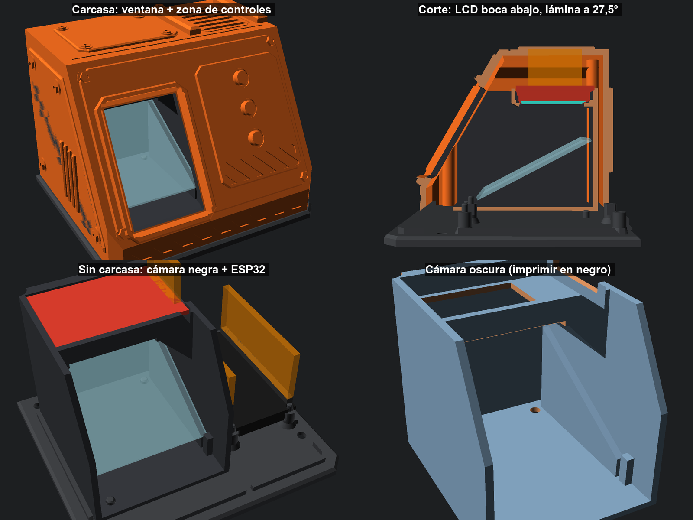

# 02 · Holo module (work in progress)

A wider version of the [console](../01-console) wedge with a "holographic" screen. The LCD sits face down at the top of a black chamber and is reflected on a clear sheet tilted at 27.5°, so the image appears to float behind the 60° panel window. Black pixels are not reflected: only what is lit shows up.

<p align="center"></p>

## Status

- Optics and case modeled in [`case/source/holo_module.scad`](case/source/holo_module.scad): shell, black chamber, base and sheet. No collisions between parts.
- First test on the real board: a 40 fps wireframe demo ([`firmware/demo_holograma.py`](firmware/demo_holograma.py)) reflected on a CD case lid. The effect works; a scratched lid also reflects some of the screen's backlight.
- Next: print the chamber alone as a test rig, confirm the image orientation, then design the side controls (button, potentiometer, passive buzzer).

## Parts

| Part | Notes |
|---|---|
| `holo_shell.stl` | Main case, 94.4 × 83.2 × 72.2 mm |
| `holo_chamber.stl` | Black chamber, 48.6 × 61.2 × 51.5 mm. Print in black. It also works on its own as a test rig |
| `holo_base.stl` | Bottom plate with ESP32 standoffs |
| `holo_glass.stl` | Reference only: cut a 44 × 49 mm piece from a CD case lid (about 1.3 mm thick) |

## Try the demo

From the repository root, with the board connected by USB:

```sh
source .venv/bin/activate
mpremote connect /dev/cu.usbserial-0001 run 02-holo/firmware/demo_holograma.py
```

It cycles mirror orientations every 10 seconds with the name on screen, so you can see which one reads correctly in the reflection. Press **EN** to go back to the installed firmware.
