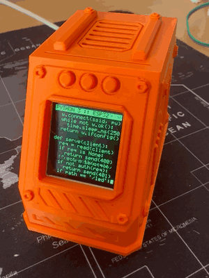

# ESP32 Retro Sci-Fi Modules

A growing set of small desk modules built around an ESP32 and a 1.44" ST7735S screen, each with a 3D-printed retro-futuristic case. They share the same style, so side by side they read as one retro sci-fi control panel.

<p align="center">
  
</p>

## Modules

| # | Module | Status | What it is |
|---|---|---|---|
| 01 | [Console](01-console) | Published on MakerWorld | Wedge console with the screen on a 60° panel. Animated screen modes, Wi-Fi API |
| 02 | [Holo](02-holo) | In progress | Same wedge, wider. The screen is reflected on a tilted clear sheet (Pepper's ghost), so the image floats inside the case |

## Repository layout

Every module has the same folders:

```
NN-module/
├── README.md     what it is, wiring, how to build it
├── firmware/     MicroPython code for the ESP32
├── case/         source/ (OpenSCAD), stl/, Bambu Studio 3MF, reference models
├── makerworld/   listing package: covers, images, video, documentation, description
└── docs/         diagrams and images used by the README
```

## Web control panel

The Next.js panel that controls the modules over Wi-Fi lives in its own repository: [esp32-sci-fi-retro-panel](https://github.com/lamaro/esp32-sci-fi-retro-panel). Its README walks through flashing a board and connecting it to the panel.

## Tooling

One Python environment at the root serves every module:

```sh
python3 -m venv .venv
source .venv/bin/activate
python -m pip install esptool mpremote
```

The cases are parametric OpenSCAD models. Export a part with `openscad --backend=manifold -o part.stl -D 'part="shell"' case/source/<model>.scad`.

Secrets (`wifi_secrets.py`, `.env.local`), the MicroPython `.bin` and the original phone photos in `makerworld/originals/` are ignored by Git.
